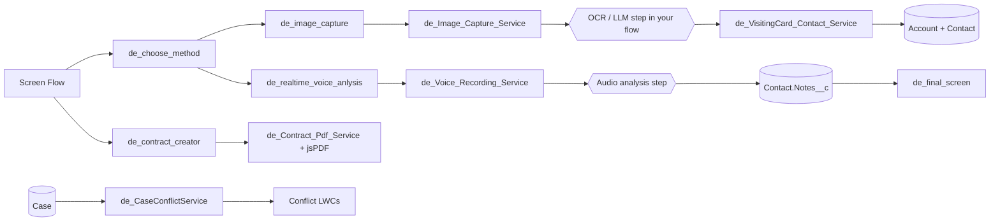

# Visit Snap

Capture a field visit in a few taps: snap a visiting card, record or upload notes, and let the flow create the Contact, analyse the conversation and draft a contract PDF, with conflict checks so two reps do not work the same customer.

## What it does

- **Choose a capture method** (`de_choose_method`) at the start of a Screen Flow.
- **Image capture** (`de_image_capture`, `de_flowNext_ImageCap`) saves a photo (e.g. a visiting card) as a File on a record via `de_Image_Capture_Service`.
- **Visiting card to Contact** - `de_VisitingCard_Contact_Service` takes OCR/LLM JSON for one or many cards and creates Account (per company) and Contact records.
- **Voice** - `de_realtime_voice_anlysis` records audio in the browser and saves it to the Contact via `de_Voice_Recording_Service`; downstream analysis writes JSON to `Contact.Notes__c`, shown by `de_final_screen`.
- **Notes upload** (`de_notes_upload`), client confirmation (`de_poc_client_confirmation`) and a completion screen (`de_flow_finished`).
- **Contract PDF** - `de_contract_creator` + `de_Contract_Pdf_Service` fill a template (static resource) and render a PDF client-side with jsPDF.
- **Conflict checks** - `de_CaseConflictService` and the `de_Case{Account,Case,Contact,Home}Conflict` LWCs detect overlapping Cases for an Account, Contact or partner user.
- **Account research** demo UI (`de_dummy_Account_Research`) with canned data.

## Architecture



## Components

| Area | Items |
|---|---|
| LWC (flow) | `de_choose_method`, `de_image_capture`, `de_flowNext_ImageCap`, `de_flowNextButton`, `de_realtime_voice_anlysis`, `de_notes_upload`, `de_poc_client_confirmation`, `de_final_screen`, `de_flow_finished`, `de_contract_creator` |
| LWC (conflicts) | `de_CaseAccountConflict`, `de_CaseCaseConflict`, `de_CaseContactConflict`, `de_CaseHomeConflict` |
| LWC (demo) | `de_dummy_Account_Research` |
| Apex | `de_Image_Capture_Service`, `de_VisitingCard_Contact_Service`, `de_Voice_Recording_Service`, `de_Contract_Pdf_Service`, `de_CaseConflictService`, `de_dummy_Account_Research_Apex` (+ tests) |
| Data | `Contact.Notes__c`, `Case.de_Adverse_Client__c` |
| Static resources | `de_jspdf` (third-party jsPDF), `de_contract_template_demo` (sample agreement) |

## Prerequisites

- Salesforce CLI and an org with Cases, Contacts and Salesforce Files.
- The orchestrating Screen Flows and the OCR / audio-analysis steps (prompt template, Agentforce action or external service) are **not** included; wire your own between the capture components and the services above.

## Setup and deploy

```bash
sf project deploy start --source-dir force-app --target-org <alias>
```

## Configuration

- Add the LWCs to a Screen Flow / Contact record page via App Builder.
- Provide the LLM/OCR integration that produces the card JSON (`CardEnvelope` shape in `de_VisitingCard_Contact_Service`) using a Named Credential or a Prompt Template of your own. No keys are stored in this repo.
- Replace the demo contract text in `de_contract_template_demo`.

## Screenshots

Add screenshots to `docs/screenshots/`.

## License

MIT, see [LICENSE](LICENSE). jsPDF is bundled under its own MIT license.
